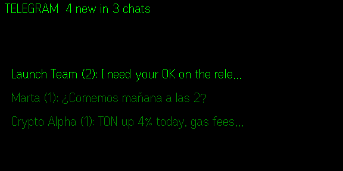
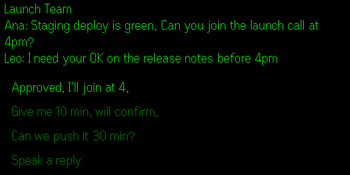

# Semilla Glance — Telegram on Even Realities G2

**Read new Telegram messages from the chats you choose at a glance. Reply with one tap on an AI-drafted answer, or by voice. Every send needs one confirming tap.**

Built by **Semilla1 Lab** for *Heads Up: Even Realities Hackathon* (Nov 23–29, 2026).
Main track: **01 · Messaging & News (Telegram)** · also entering **Best Telegram integration**. Second track (optional): **04 · AI Assistants & Work** (OpenRouter / Claude / ChatGPT for drafts).

**Demo video (59 s, Even Hub simulator):** [Watch / download `semilla-glance-demo.mp4`](https://github.com/semilla1lab/semilla-glance/releases/download/v0.1.0/semilla-glance-demo.mp4) (also committed in [`demo/semilla-glance-demo.mp4`](demo/semilla-glance-demo.mp4)).

| Inbox | Chat + AI drafts | Confirm |
|---|---|---|
|  |  |  |

## The everyday moment

You're walking into a meeting and your phone buzzes three times. Pulling it out means losing the room.
With Semilla Glance on G2 you see *only* the chats you allowed ("Launch Team", your partner, one alpha channel), get the gist in one line, and answer with a tap:

1. **Inbox** — `TELEGRAM 4 new in 3 chats`, one line per chat, newest first. Muted/unknown chats never show up.
2. **Digest** (context menu) — every allowed chat summarized in one glance.
3. **Chat** — last 1–3 unread messages + **3 AI drafts** (accept · need time · ask), in the chat's language.
4. **Speak a reply** — G2 mic streams 16 kHz PCM → backend STT (Whisper-compatible) → the LLM cleans "um / uh" into a short reply.
5. **Confirm** — `Send to Launch Team? "Approved. I'll join at 4."` → **Send / Speak again / Cancel**. The reply is posted as a threaded reply to the last message.

Controls: **tap** = open/choose · **scroll** (touchpad or R1 ring) = move · **double tap** = back · **menu** = Digest / Refresh / Inbox.

## Architecture

```
G2 glasses ──BLE── Even Realities App (WebView)
                     └─ web/ (Even Hub SDK 0.0.16: list/text containers, mic, menu)
                          │ HTTPS + pairing code (no Google sign-in in WebView)
                          ▼
                   server/ (Node 20+, zero runtime deps)
                     ├─ telegram.mjs  Telegram Bot API: getUpdates (read) + sendMessage (write)
                     ├─ ai.mjs        any OpenAI-compatible LLM (OpenRouter, OpenAI, Claude via OpenRouter, local Ollama)
                     │                deterministic offline fallback when no key is set
                     └─ stt.mjs       PCM16 → WAV → any OpenAI-compatible /audio/transcriptions (Whisper, Groq, faster-whisper)
```

- **Keys never ship in the app**: Telegram token, LLM key and STT key live only on the backend (`.env`), as the hackathon rules require.
- **Allow-list** (`GLANCE_ALLOW_CHATS`): the app can only read from and send to chats you list.
- **Two-step send**: `/api/prepare` returns a single-use token valid 2 min; only `/api/confirm` (the "Send" tap) posts to Telegram. Tested.
- **Pairing code** instead of Google sign-in (which doesn't work in the WebView).

## Run it

Requirements: Node.js ≥ 20. Linux simulator also needs `libwebkit2gtk-4.1-0`.

```bash
npm install
npm run build

# A) Demo without any account: local mock of the Telegram Bot API (same JSON shapes)
npm run demo            # backend on http://127.0.0.1:8787, pair code DEMO42
npm run sim             # official Even Hub simulator pointed at the app

# B) Real Telegram
cp .env.example .env    # set TELEGRAM_BOT_TOKEN from @BotFather, add the bot to your group(s)
set -a; . ./.env; set +a
npm start               # prints the pair code; open http://<host>:8787/?pair=<code> in the simulator / Even App
```

### Tests

```bash
npm test                # 8 backend tests: auth, allow-list, drafts, prepare/confirm single-use, voice, WAV
xvfb-run -a npm run e2e # drives the official simulator via its automation API (port 9898):
                        # digest → chat → AI draft → confirm → send; chat → speak → confirm → send
                        # asserts exactly 2 messages reached (mock) Telegram, saves glasses frames to demo/frames/
```

### Package for Even Hub

```bash
BACKEND_URL=https://your-backend.example npm run pack   # → semilla-glance.ehpk (update the whitelist in app.json)
```

## What existed before Nov 23, 2026

Nothing project-specific. Everything in this repo was written during the hackathon (Nov 25, 2026).
Third-party: `@evenrealities/even_hub_sdk` (MIT), `@evenrealities/evenhub-cli` and `@evenrealities/evenhub-simulator` (dev tools), `esbuild` (bundler). The backend has no runtime dependencies.

## Honest limits (v0.1)

- Telegram **Bot API** reads groups/channels where the bot is a member and DMs sent to the bot — not your personal account's DMs (that needs MTProto/TDLib, planned).
- The recorded demo uses the **local mock** of the Bot API and the **offline** draft/voice fallbacks (no keys on the recording machine). With `LLM_*` / `STT_*` set, drafts and transcription come from the real models.
- Tested in the official simulator v0.9.5; not yet on physical G2 hardware.

## Safety & privacy

Read-only by default; nothing is sent without an explicit confirming tap. No message is stored on disk (in-memory, last 30 per chat). No financial actions. No API keys or secrets in the repo.

## License

MIT © 2026 Semilla1 Lab
